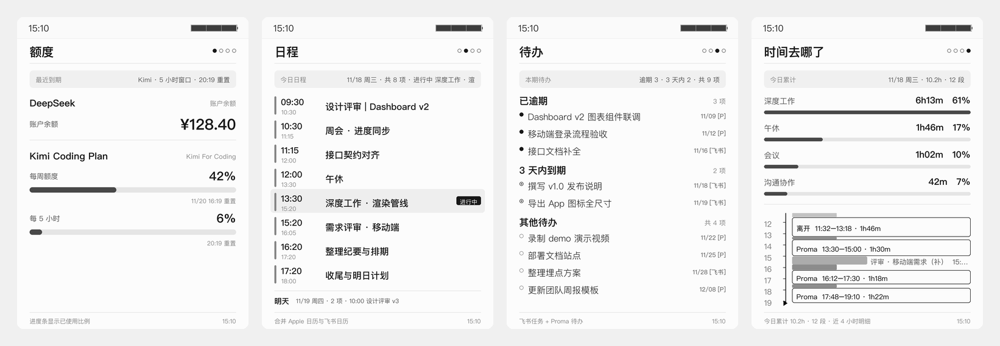
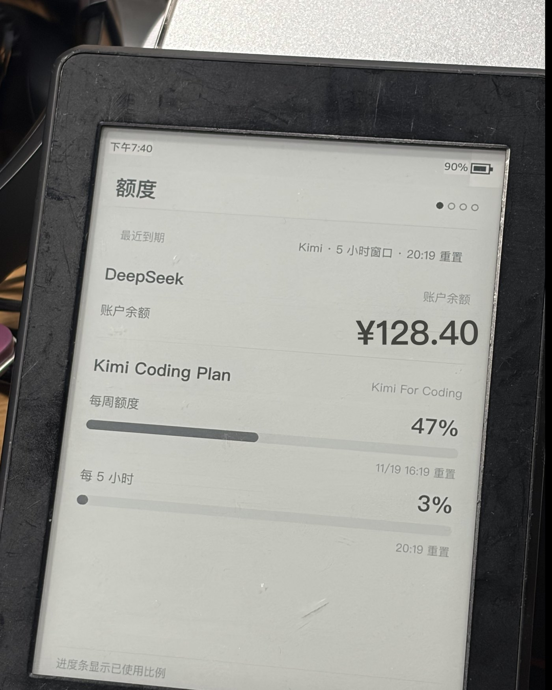

# Kindle E-ink Dashboard for Kindle Paperwhite

Turn an idle Kindle Paperwhite 3 into an always-on desk dashboard: four rotating
pages, rendered locally on a Mac, nothing leaves your LAN.


English · [中文](./README.md)



---

## On a real desk



## What it is

A jailbroken Kindle Paperwhite 3 (1072 × 1448, 16-level grayscale) used as a desk
secondary display. A Mac renders four PNG pages every 5 minutes; the Kindle pulls
them over HTTP with `wget` and paints them with `eips`:

| Page | Content |
| --- | --- |
| **Quota** | Model API balance and rate-limit windows (DeepSeek / Kimi Coding Plan) |
| **Schedule** | Today's events, Apple Calendar + Lark Calendar merged and de-duplicated, current event highlighted |
| **Todos** | Lark tasks + local todos, overdue items inverted and pinned to the top |
| **Where time went** | Foreground-app time tracking with manual backfill, daily breakdown by category |

E-ink is a natural fit: **no refresh means no power draw, no backlight means no glare,
and the image survives network loss**. It hangs next to your monitor and shows how
much work is left today.

## Features

**The four pages**

- 1072×1448 monochrome layout, rotating every 5 minutes, tap the middle area to advance
- One shared visual spec (`render/dash_style.py`): title baseline, page dots, gray levels, bars all aligned
- Schedule page merges Apple Calendar and Lark Calendar, de-duplicated by (title, minute)
- Todo page merges Lark tasks and local todos; overdue items are inverted
- Timeline page classifies foreground apps automatically (deep work / meetings / comms / browsing / away / lunch) with manual overrides

**Device side**

- WiFi + SSH (dropbear) + HTTP image pull — **the Kindle pulls; the Mac never reaches out**
- Deep sleep or network loss does not matter: the device fetches the latest frame on wake
- Touch to page, power button to exit, auto-suspend at 21:00 with RTC wake at 09:00
- Uses the Kindle's **native status bar** (clock + battery) instead of drawing our own
- Self-healing status bar: detects a missing clock/battery and runs `restart powerd`

**Mac side**

- Five LaunchAgents: render (5 min), image server (KeepAlive), time logger (1 min), watchdog (1 min),
  macOS menu bar status icon (always on)
- Menu bar status: a colour dot plus time since the last pull tells you at a glance whether the
  image host, the renderer and the Kindle are all on schedule (see below)
- Watchdog locates the device by MAC, gates rendering on a private IP, rate-limits SSH recovery
- Every long-running entry point is `.py` (see the TCC note below) so `~/Downloads` is not blocked
- Weekly report: `render/weekly_report.py` summarizes the week and can push to Lark

## Quick start

### 1. Mac side (get rendering working first)

```bash
git clone https://github.com/yinsitong/kindle-ink-dash.git
cd kindle-ink-dash
pip3 install -r requirements.txt          # Pillow only

cp data/config.env.example data/config.env
$EDITOR data/config.env                   # at minimum, set KINDLE_MAC

python3 scripts/make_demo_assets.py       # render four demo pages
open docs/assets/demo/overview.png
```

If you get an image, the pipeline works. Then install the background services:

```bash
bash install.sh        # generates and loads four LaunchAgents (paths auto-filled)
bash uninstall.sh      # remove; add --purge to delete data too
```

> Re-run `install.sh` after moving the project directory.

### 2. Kindle side (requires a jailbreak)

Download links and the exact order for WinterBreak, Hotfix, KUAL, MRPI and USBNetwork
are in **[`docs/越狱工具清单.md`](docs/越狱工具清单.md)**. This repo ships **no**
jailbreak binaries and no Amazon firmware.

Once the device is ready:

```bash
ssh root@<kindle-ip> 'mkdir -p /mnt/us/kindle-dash'
scp device/dash.sh device/launch.sh root@<kindle-ip>:/mnt/us/kindle-dash/

# point the device at your Mac's LAN address
ssh root@<kindle-ip> 'echo "DASH_SERVER=\"http://<mac-ip>:8077/quota.png\"" > /mnt/us/kindle-dash/config.sh'

ssh root@<kindle-ip> 'sh /mnt/us/kindle-dash/launch.sh'
```

The step-by-step guide (jailbreak, SSH setup, autostart) is in
**[`docs/Kindle魔改看板-完整教程.md`](docs/Kindle魔改看板-完整教程.md)** (Chinese).

## Architecture

```text
Mac                                                       Kindle
┌───────────────────────────────────────┐
│ launchd                               │
│  ├─ render_all.py    every 5 min      │   ① Mac renders four PNGs
│  │    └→ render/*.py ─→ data/pages/   │
│  ├─ serve.py         :8077 image host │   ② Kindle pulls with wget
│  ├─ time_logger.py   every 1 min      │   ③ image painted below y=100
│  ├─ watchdog.py      every 1 min      │   ④ top 100px keeps native status bar
│  └─ menubar.py       menu bar status  │
└───────────────────────────────────────┘
                     ↑ SSH (address / process recovery, rate-limited)
                     │
              <kindle-ip> ────────────────→ eips
```

Key design: **the Kindle pulls**. The Mac never connects to the device, so deep sleep
and network loss are harmless — the device fetches the latest frame on wake. SSH is
only used for recovery, and it is rate-limited: knocking every minute wakes the WiFi
radio and drains the battery.

## Dependencies and optional parts

| Feature | Requires | Without it |
| --- | --- | --- |
| Four-page rendering | Python 3 + Pillow | — |
| Schedule page | [Lark CLI](https://github.com/larksuite/cli) `lark-cli` + macOS calendar permission | shows Apple Calendar only |
| Todo page | `lark-cli` + `~/.proma/planning.db` (optional) | shows whichever source is available |
| Quota page | a module exposing `query_deepseek` / `query_kimi` | that page shows N/A; other pages unaffected |
| Timeline page | macOS `osascript` (foreground app) | manual backfill only |
| Mac menu bar icon | `pyobjc-framework-Cocoa` (`install.sh` installs it) | icon skipped, everything else keeps running |

Everything configurable lives in `data/config.env` (gitignored); see
[`data/config.env.example`](data/config.env.example).

## Why every entry point is Python (do not switch back to shell)

macOS TCC treats `~/Downloads` as protected. Measured:

| Executor | Result |
| --- | --- |
| `/bin/sh`, `/bin/bash` via launchd on a Downloads script | **exit 126** (`is Platform Binary → Deny`) |
| Python.framework `python3` via launchd on the same script | **exit 0**, full read/write |

So all long-running entry points are `.py` and call `ssh` / `ipconfig` / `pgrep`
through `subprocess`. Switching a plist back to `/bin/sh` makes it fail with 126.

> Without living in `~/Downloads` this restriction does not apply, but keeping Python
> entry points is more portable anyway.

## macOS menu bar: is the dashboard alive?

Because **the Kindle pulls**, a static screen tells you nothing: the content may not have
changed, the device may be asleep, or the Mac side may be broken. The menu bar reduces all
of that to one colour.

Title = `📟` + colour dot + time since the last pull (e.g. `📟🟢3m`, `📟🟡17h`):

| Icon | Meaning |
| --- | --- |
| 🟢 `3m` | All good. The number is minutes since the Kindle's last pull (normal cadence: 5 min) |
| 🟡 | Something is off: no pull for over 12 min during the day, rendering stalled, or a page failed |
| 🔴 | Nothing listening on `:8077` — the Kindle cannot fetch an image right now |
| 🌙 | Night sleep (no pulls between 21:00 and 09:00 is by design in `dash.sh`) |

Open the menu for details and shortcuts:

- Image host state and PID, the Kindle's IP and last pull, freshness of each of the four pages, the Mac's IP
- A failing page states its reason (e.g. "quota page: set DEEPSEEK_API_KEY")
- One-click: open preview, render now, restart image host, open project folder, open logs

How it works (`bin/menubar.py`, refreshes every 30 s):

- Everything is derived from existing artefacts, so **the device is never disturbed**: a TCP connect to
  `:8077` for the image host (never `/quota.png` — that would advance the rotation), the last
  `<ip> <- <page>` line in `data/server.log`, and mtimes of `data/pages/*.png` plus
  `/tmp/kindle-render.log` for rendering
- Loopback and local-IP requests are ignored — those come from the install self-check or a browser
  preview, not from the device
- Health checks use `/health`, which neither advances the rotation nor writes the access log
- Single instance: a second launch exits; "Quit" really quits, only crashes are restarted by launchd

## The status bar: use the Kindle's own

The native status bar (clock top-left, battery top-right) is drawn by `pillowd`; this
project does not draw it.

Problem: `eips` painting covers the top bar with white, and `pillowd` does not redraw
proactively — the clock comes back on the next minute tick, but **the battery has no
redraw trigger and disappears for good**. That is the real cause of "battery icon
sometimes shows, sometimes not".

Fix: render the body only below `y=100` (`eips -g IMG -x 0 -y 100`); the top 100px is
never touched.

Recovery when it breaks — clock and battery are driven by different components:

| Method | Effect |
| --- | --- |
| `lipc-set-prop com.lab126.pillow displayChrome 1` | ❌ no-op on this firmware (`Property found but with a different type`) |
| `initctl restart pillow` | ⚠️ clock only, and only after the next minute tick |
| `initctl restart powerd` | ✅ the only reliable one: clock and battery both return |

`device/launch.sh` therefore: detect an incomplete status bar → whiten the top strip if
needed → `initctl restart powerd` → restore `preventScreenSaver 1`.

Detection must be **split left/right**: left half (x<500) for the clock, right half
(x>600) for the battery, average ≥200 for a white background. Counting dark pixels
alone misjudges a wallpaper overlay as healthy (measured: 21836 dark pixels).

Also: **`/var` is a 64MB tmpfs**. When it fills up, `dd` and `eips` fail *silently*.
`launch.sh` truncates logs over 300 lines and clears screen-grab leftovers at start.

## Six gotchas

1. **The Kindle's IP drifts.** A long-powered-off device loses its DHCP lease.
   `bin/kindle_ip.py` degrades gracefully: ARP by MAC → probe historical IPs →
   scan port 22 and verify `uname -n` contains `kindle` → ping sweep to wake.
2. **Do not gate rendering on a subnet.** After a router change, code keyed to an old
   subnet silently `exit 0`s every 5 minutes and the dashboard stays dark for days.
   Render whenever a private IP exists — rendering is purely local.
3. **Do not SSH every minute.** It pulls the WiFi radio out of sleep. All recovery is
   rate-limited to once per 10 minutes and only fires immediately if the IP changed.
4. **launchd kills children of interval jobs.** A `nohup` service started from a
   `StartInterval` agent dies with it. The image server therefore has its own KeepAlive
   agent, and the watchdog sets `AbandonProcessGroup`.
5. **`pkill -f "dash\.sh"` kills your SSH session.** Use the exact path
   `pkill -f "/tmp/dash\.sh"`.
6. **Do not verify the screen with `eips -k`.** It dumps 16bpp raw data, not a viewable
   image. Use `dd if=/dev/fb0 bs=1088 count=1448` and read it as
   `(1448, 1088)[:, :1072]`.

## Visual spec

Everything lives in `render/dash_style.py` and affects all four pages.

- Body canvas `1072×1348` (1448 minus the 100px status bar)
- Title baseline y=22, rule y=114, page dots center y=56 — identical on all pages
- Grays: `BG=252` / `INK=24` / `INK_MID=84` / `INK_SOFT=132` / `RULE=222`
- Font: PingFang SC (six weights), falls back to STHeiti
- Quota page semantics: **bar = used / total** (not remaining)

## Layout

```text
bin/          long-running entry points (all .py — see the TCC note)
              serve.py / render_all.py / time_logger.py / watchdog.py / menubar.py / kindle_ip.py
render/       page renderers + weekly report
scripts/      make_demo_assets.py — renders the README images from fake data
device/       Kindle-side scripts (dash.sh, launch.sh, KUAL extensions)
data/         runtime data (gitignored): timelog/ pages/ reports/ config.env
docs/         tutorial, jailbreak tool list, device notes, demo images
```

## Limitations

- Requires a **jailbroken** Kindle (PW3 firmware ≤ 5.16.2.1.1); without a jailbreak `eips` is unavailable
- Layout is tuned for 1072×1448; other models need `SCREEN_W/H` changes in `dash_style.py`
- Schedule and todo pages depend on Lark CLI and macOS calendar permission
- E-ink ghosting: this project does a full `gc16` refresh every time, which flashes briefly
- RTC wake from deep sleep is not fully reliable; sometimes the device needs a touch

## Credits

- Jailbreak and device environment: community toolchain (WinterBreak / Hotfix / KUAL / MRPI / USBNetwork) — see [`docs/越狱工具清单.md`](docs/越狱工具清单.md)
- Font: PingFang SC (macOS system font)
- The screen content in the photo is demo data; the account balance was replaced with a fictional value

## License

[MIT](LICENSE) © 2026 Stone Yin
