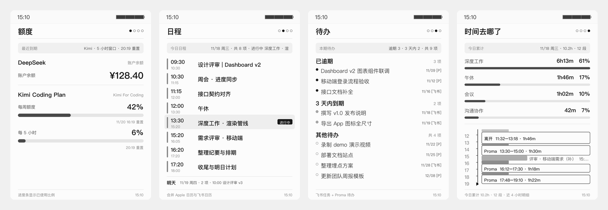

# Kindle 墨水屏看板 · E-ink Dashboard for Kindle Paperwhite

把一台吃灰的 Kindle Paperwhite 3 变成常亮的桌面副屏：四页轮播，Mac 本地渲染，数据不出局域网。


[English](./README.en.md) · 中文



---

## 它是什么

一台 Kindle Paperwhite 3（1072 × 1448，16 级灰度）越狱后当桌面副屏用。
Mac 每 5 分钟渲染四页 PNG，Kindle 用 `wget` 主动拉图、`eips` 上屏：

| 页 | 内容 |
| --- | --- |
| **额度** | 模型 API 余额与额度窗口（DeepSeek / Kimi Coding Plan） |
| **日程** | 今日日程（Apple 日历 + 飞书日历合并去重），进行中高亮 |
| **待办** | 飞书任务 + 本地待办，逾期反色置顶 |
| **时间去哪了** | 前台应用自动采集 + 手动补录，按类别统计当日时间分布 |

电子墨水屏的物理特性正好合适：**不刷新不耗电、无背光不刺眼、断网也保持画面**。
它安静地挂在显示器旁边，抬头就能看到今天还剩多少活。

## 能力

**看板四页**

- 1072×1448 单色页面，四页轮播，触摸中间区域手动翻页
- 统一视觉规范（`render/dash_style.py`）：标题基线、页码点、灰度层次、进度条全部对齐
- 日程页合并 Apple 日历与飞书日历并按 (标题, 时刻) 去重
- 待办页合并飞书任务与本地待办，逾期项反色置顶
- 时间线页按前台 App 自动归类（深度工作 / 会议 / 沟通 / 浏览 / 离开 / 午休），
  支持手动补录覆盖自动段

**设备侧**

- WiFi + SSH（dropbear）+ HTTP 拉图，**Kindle 主动拉，Mac 不主动连设备**
- 设备深睡断网不影响：醒来自己拉最新图
- 触摸翻页、电源键锁屏退出、21:00 自动挂起 / 09:00 RTC 唤醒
- 保留 Kindle 原生状态栏（左上角时间 + 右上角电池），不自绘
- 原生状态栏自愈：检测到时间/电池缺失自动 `restart powerd` 恢复

**Mac 侧**

- 四个 LaunchAgent：渲染（5 分钟）、图床（常驻 KeepAlive）、时间采集（1 分钟）、看门狗（1 分钟）
- 看门狗按 MAC 定位设备、按私有 IP 判定是否渲染、限频 SSH 自愈
- 全部入口是 `.py`（见下方 TCC 说明），避免 `~/Downloads` 被 TCC 拒绝
- 周报：`render/weekly_report.py` 汇总一周时间分布，可推送飞书

## 快速开始

### 1. Mac 端（先跑通渲染）

```bash
git clone https://github.com/yinsitong/kindle-ink-dash.git
cd kindle-ink-dash
pip3 install -r requirements.txt          # 只需要 Pillow

cp data/config.env.example data/config.env
$EDITOR data/config.env                   # 至少填 KINDLE_MAC

python3 scripts/make_demo_assets.py       # 用假数据渲染四页，验证环境
open docs/assets/demo/overview.png
```

能出图说明渲染链路正常。接着装后台服务：

```bash
bash install.sh        # 生成并加载 4 个 LaunchAgent（路径自动填当前目录）
bash uninstall.sh      # 卸载；加 --purge 连数据一起删
```

> 项目移动位置后**重跑一次 `install.sh`** 即可，路径会重新填。

### 2. Kindle 端（需要先越狱）

越狱、Hotfix、KUAL、MRPI、USBNetwork 的下载地址与顺序见
**[`docs/越狱工具清单.md`](docs/越狱工具清单.md)**——本仓库不含任何越狱二进制，
也不分发 Amazon 固件。

设备就绪后：

```bash
# 在 Kindle 上准备部署目录
ssh root@<kindle-ip> 'mkdir -p /mnt/us/kindle-dash'

# 推送设备端脚本
scp device/dash.sh device/launch.sh root@<kindle-ip>:/mnt/us/kindle-dash/

# 写入图床地址（IP 换成运行 serve.py 那台 Mac 的局域网地址）
ssh root@<kindle-ip> 'echo "DASH_SERVER=\"http://<mac-ip>:8077/quota.png\"" > /mnt/us/kindle-dash/config.sh'

# 启动
ssh root@<kindle-ip> 'sh /mnt/us/kindle-dash/launch.sh'
```

完整的分步教程（含越狱全过程、SSH 配置、开机自启）见
**[`docs/Kindle魔改看板-完整教程.md`](docs/Kindle魔改看板-完整教程.md)**。

## 架构

```text
Mac 端                                                    Kindle 端
┌───────────────────────────────────────┐
│ launchd                               │
│  ├─ render_all.py    每 5 分钟         │   ① Mac 渲染四页 PNG
│  │    └→ render/*.py ─→ data/pages/   │
│  ├─ serve.py         :8077 图床        │   ② Kindle 用 wget 轮播拉图
│  ├─ time_logger.py   每 1 分钟采集前台App│   ③ 主图贴 y=100 以下
│  └─ watchdog.py      每 1 分钟自愈      │   ④ 顶部 100px 留给原生状态栏
└───────────────────────────────────────┘
                     ↑ SSH（地址/进程自愈，限频）
                     │
              <kindle-ip> ────────────────→ eips 上屏
```

关键设计：**Kindle 主动来拉图**。Mac 不需要主动连设备，设备深睡断网也不影响，
醒来自己拉最新图。SSH 只用于自愈（改地址、重启看板），且做了限频——
每分钟敲门会把 Kindle 的 WiFi 从休眠里拽起来，白耗电。

## 依赖与可选功能

| 功能 | 依赖 | 不配置时 |
| --- | --- | --- |
| 四页渲染（基础） | Python 3 + Pillow | — |
| 日程页 | [飞书 CLI](https://github.com/larksuite/cli) `lark-cli` + macOS 日历权限 | 只显示 Apple 日历部分 |
| 待办页 | `lark-cli` + `~/.proma/planning.db`（可选） | 只显示能读到的那一路 |
| 额度页 | 一个提供 `query_deepseek` / `query_kimi` 的模块 | 该页显示 N/A，其余三页正常 |
| 时间线页 | macOS `osascript`（采集前台 App） | 只能靠手动补录 |

所有可选配置都在 `data/config.env`（已 gitignore），模板见
[`data/config.env.example`](data/config.env.example)。

## 为什么入口都是 Python（重要，别改回 shell）

macOS 的 TCC 把 `~/Downloads` 列为受保护目录。实测：

| 执行者 | 结果 |
| --- | --- |
| `/bin/sh`、`/bin/bash` 经 launchd 执行 Downloads 里的脚本 | **exit 126**（`is Platform Binary → Deny`） |
| Python.framework 的 `python3` 经 launchd 执行同样脚本 | **exit 0**，正常读写 |

所以常驻入口一律用 `.py`，内部再用 `subprocess` 调 `ssh` / `ipconfig` / `pgrep`。
plist 里若改回 `/bin/sh`，服务会立刻 126 失败。

 > 项目不放在 `~/Downloads` 时没有这个限制，但仍建议保持现状：Python 入口跨环境更稳。

## 状态栏：时间与电池都用 Kindle 自带的

Kindle 原生状态栏（左上角时间 + 右上角电池）由 `pillowd` 绘制，本项**不自绘**。

但 `eips` 贴图会把顶栏盖白，而 `pillowd` 不会主动补画——时间会随分钟跳变重绘回来，
**电池没有重绘触发，会长期缺失**。这就是「电池一会儿有一会儿没有」的真因。

正确做法：正文图只画到 `y=100` 以下（`eips -g IMG -x 0 -y 100`），顶部 100px 永不覆盖。

被破坏了怎么恢复？时间和电池由不同组件驱动，手段不同（逐条实测）：

| 手段 | 效果 |
| --- | --- |
| `lipc-set-prop com.lab126.pillow displayChrome 1` | ❌ 无效。日志报 `Property found but with a different type` |
| `initctl restart pillow` | ⚠️ 只恢复时间，且要等下一次分钟跳变；电池仍缺 |
| `initctl restart powerd` | ✅ 唯一可靠：时间和电池一起恢复 |

所以 `device/launch.sh` 的自愈流程是：检测状态栏不完整 → 顶部不白先刷白 →
`initctl restart powerd` → 恢复后补回 `preventScreenSaver 1`。

检测必须**左右分区**：左半（x<500）判时间、右半（x>600）判电池、整区均值 ≥200 判白底。
只看「深色像素数超过阈值」会把壁纸覆盖误判成正常——实测壁纸覆盖时深色像素高达 21836。

另一个隐患：**`/var` 是 64MB tmpfs**，写满后 `dd` / `eips` 会静默失败（画面异常但无报错）。
`launch.sh` 启动时会截断超 300 行的日志、清抓屏残留，空间低于 8MB 再深度清理。

## 六个会踩的坑

### 1. Kindle 的 IP 会漂移

DHCP 分配的地址在长期关机后可能被别的设备占走，表现为 ping 通但 22 端口 refused，
极易误判成「SSH 挂了」。定位策略按序降级（`bin/kindle_ip.py` + `bin/watchdog.py`）：

1. 同网段：ARP 表按 MAC 查
2. 跨网段：逐个探测 `data/.kindle-candidates` 里的历史 IP
3. 都失效：扫网段 22 端口 + `uname -n` 验证 hostname 含 kindle
4. 设备深睡：`--wake` ping 扫描刷新 ARP

「同网段 ARP 可见、跨网段不可见」是跨网段逻辑存在的原因：
当 Mac 和 Kindle 接在不同 WiFi 时，只有 TCP 探测能找回设备。

### 2. 不要按网段 gate 渲染

路由器换 LAN 段后，写死网段的旧代码会让渲染任务每 5 分钟静默 `exit 0`，
看板可能停好几天没人发现。现在只判断「有私有 IP 就渲染」——
渲染是纯本地操作，根本不需要网络。

### 3. 不要每分钟 SSH 敲门

会把 Kindle 的 WiFi 从休眠里拽起来。所有 SSH 自愈都做了限频（10 分钟一次），
且只在「IP 或 SERVER 地址变化」时立即连。

### 4. launchd 会杀掉定时任务的子进程

`StartInterval` 类型的 LaunchAgent 里用 `nohup` 起的服务，任务结束会被连带杀掉。
所以图床服务必须单独用 **KeepAlive** 的 LaunchAgent，
看门狗则加 `AbandonProcessGroup`。

### 5. `pkill -f "dash\.sh"` 会误杀 SSH 会话

SSH 命令行本身含 `dash.sh` 字样。必须写成精确路径 `pkill -f "/tmp/dash\.sh"`。

### 6. 验证屏幕内容别用 `eips -k`

`eips -k file` 存的不是可读画面（16bpp 原始数据）。要验证真实显示内容：

```sh
ssh root@<ip> 'dd if=/dev/fb0 bs=1088 count=1448' > fb.raw   # 8bpp，行宽 1088
```

再用 PIL 读成 `(1448, 1088)[:, :1072]`。

## 四页视觉规范

全部走 `render/dash_style.py`，改这里同时影响四页。

- 正文画布 `1072×1348`（1448 − 顶部 100px 状态栏）
- 标题基线 y=22、分隔线 y=114、右上页码点中心 y=56（四页完全一致）
- 灰度：`BG=252` 底 / `INK=24` 主文字 / `INK_MID=84` / `INK_SOFT=132` / `RULE=222` 分隔线
- 字体：PingFang SC（六档字重），缺字体时自动回退 STHeiti
- 额度页语义：**进度条 = 已使用 / 总额度**（不是「待使用」）

## 目录

```text
bin/          常驻入口（全部是 .py，见 TCC 说明）
  serve.py        :8077 图床 + 轮播
  render_all.py   每 5 分钟渲染四页
  time_logger.py  每分钟采集前台 App
  watchdog.py     每分钟自愈（IP / 服务 / 设备）
  kindle_ip.py    按 MAC 定位 Kindle 的 IP
render/       渲染脚本
  dash_style.py          四页共用视觉规范（改样式只改这里）
  dash_paths.py          路径与配置解析（项目可整体移动）
  render_schedule.py     日程页
  render_todo.py         待办页
  render_timeline.py     时间线页
  kindle_quota_render.py 额度页
  minutes_annotate.py    用飞书妙记自动补录会议时间
  weekly_report.py       周报 + 飞书推送
scripts/      开发工具
  make_demo_assets.py    用假数据渲染 README 演示图
device/       Kindle 端脚本
  dash.sh      看板循环（轮播 / 触摸翻页 / 夜间放睡）
  launch.sh    启动器（含原生状态栏自愈）
  kual/        KUAL 扩展（SSH 启动/修复、USBNetwork 安装）
data/         运行数据（gitignore）：timelog/ pages/ reports/ config.env
docs/         教程、越狱工具清单、设备笔记、演示图
```

## 调参位置

| 想改什么 | 改哪里 |
| --- | --- |
| 轮播间隔 / 夜间放睡时间 | `device/dash.sh` 顶部 `INTERVAL`、`NIGHT_START`、`NIGHT_END` |
| 四页配色与字号 | `render/dash_style.py` |
| 应用分类（深度工作 / 会议 / 浏览 …） | `render/render_timeline.py` 的 `CATEGORIES` |
| 会议时长来源 | 飞书妙记（`render/minutes_annotate.py` 自动补录） |
| Kindle 的 MAC | `data/config.env` 的 `KINDLE_MAC` |
| 跨网段 / 唤醒扫描频率 | `bin/watchdog.py` 的 `CROSS_INTERVAL` |

## 已知限制

- 需要一台**已越狱**的 Kindle（PW3 固件 ≤ 5.16.2.1.1）。没有越狱的设备无法执行 `eips`
- 只针对 1072×1448 的 PW3 调过版式；其他机型改 `dash_style.py` 的 `SCREEN_W/H` 并重排
- 日程/待办依赖飞书 CLI 与 macOS 日历权限，不配置时对应区域为空
- 电子墨水屏刷新有残影：`gc16` 全刷最干净但闪一下，本项目用 `-w gc16` 每次全刷
- 深睡时 RTC 唤醒不完全可靠，偶尔要碰一下设备才真正醒来

## Credits

- 越狱与设备环境：社区工具链（WinterBreak / Hotfix / KUAL / MRPI / USBNetwork），
  清单见 [`docs/越狱工具清单.md`](docs/越狱工具清单.md)
- 字体：PingFang SC（macOS 系统字体）

## License

[MIT](LICENSE) © 2026 Stone Yin
